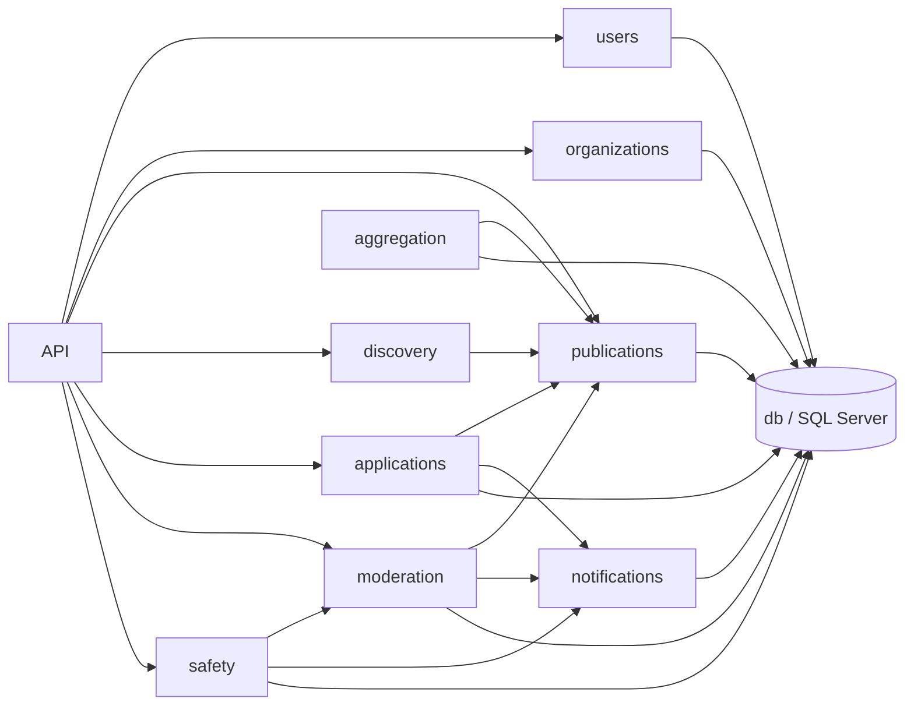
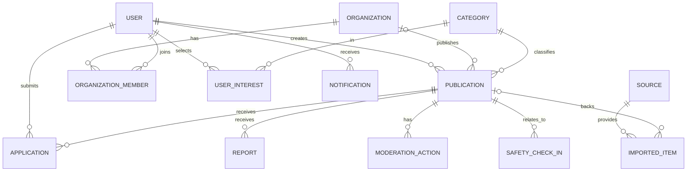

# DobroHub — spec

## 1. Що і навіщо

Вебплатформа, де люди й організації публікують та знаходять волонтерські можливості, взаємодопомогу й благодійні події. Проблема: оголошення розпорошені, багато спаму та шахрайства. Тому: модерація, перевірка організацій і добровільне підтвердження безпеки після активності.

Ролі: відвідувач, користувач, представник організації, модератор, адміністратор.

## 2. Модулі та взаємодія

Модульний моноліт (Node.js, TypeScript, Fastify, SQL Server). Модулі спілкуються лише через публічний `index.ts`, а до БД ходять через `db`.

| Модуль        | Відповідальність                                |
| ------------- | ----------------------------------------------- |
| users         | реєстрація, вхід, профіль, інтереси, ролі       |
| organizations | профіль організації, статус перевірки, учасники |
| publications  | оголошення та їхній життєвий цикл               |
| discovery     | пошук, фільтри, стрічка (лише читання)          |
| applications  | заявки на участь                                |
| moderation    | черга, скарги, рішення модераторів              |
| safety        | запити підтвердження безпеки                    |
| notifications | сповіщення про події                            |
| aggregation   | імпорт із зовнішніх джерел                      |
| db            | підключення, параметризовані запити, транзакції |

Правило залежностей: `publications` не імпортує `moderation` (мод. змінює статус через інтерфейс publications). Циклів немає. Перевіряється `make audit`.

## 3. Дані

Статуси публікації (єдиний enum): `draft | pending | published | rejected | hidden | completed`.

- **User**(id, name, email, passwordHash, role, createdAt)
- **Organization**(id, name, verificationStatus) і **OrganizationMember**(orgId, userId)
- **Category**(id, name), **UserInterest**(userId, categoryId)
- **Publication**(id, authorId, organizationId?, categoryId, title, description, status, location, startsAt, updatedAt)
- **Application**(id, publicationId, userId, status, createdAt)
- **Report**(id, publicationId, reporterId, reason, status)
- **ModerationAction**(id, publicationId, moderatorId, action, createdAt)
- **SafetyCheckIn**(id, userId, publicationId, status, scheduledAt, respondedAt)
- **Notification**(id, userId, type, entityType, entityId, status, createdAt)
- **Source**(id, name, url, enabled), **ImportedItem**(id, sourceId, externalId, publicationId)

Цілісність: зовнішні ключі; `UNIQUE(sourceId, externalId)`; унікальність активної заявки `(publicationId, userId)`.

## 4. Як оновлюються дані

1. **Публікація:** створення → `pending` → рішення модератора (запис `ModerationAction`) → `published` / `rejected` → сповіщення автору.
2. **Заявка:** перевірка, що публікація `published`, → вставка `pending` (унікальний індекс + транзакція) → організатор приймає/відхиляє → сповіщення.
3. **Імпорт:** отримати → перевірити `externalId` → якщо нового немає, створити `Publication(pending)` + `ImportedItem` в одній транзакції → модерація. Збій джерела логується, інші джерела працюють далі.
4. **Безпека:** після `startsAt + тривалість` створюється `SafetyCheckIn`; відповідь «проблема» створює звернення модератору. Поліцію автоматично не викликаємо.

## 5. Критерії приймання (версія 1)

| №    | Критерій                                                                   | Пріоритет |
| ---- | -------------------------------------------------------------------------- | --------- |
| AC-1 | Валідна реєстрація проходить, невалідна відхиляється; пароль лише як хеш   | P0        |
| AC-2 | Гість не може створити публікацію чи заявку (401)                          | P0        |
| AC-3 | Публікація `pending` не видна в публічній стрічці до схвалення             | P0        |
| AC-4 | Пошук із кількома фільтрами повертає лише відповідні записи                | P0        |
| AC-5 | Дві одночасні заявки одного користувача дають одну активну заявку          | P0        |
| AC-6 | Автор бачить заявки лише на власні публікації                              | P0        |
| AC-7 | Скарга створює запис для модератора; рішення зберігається                  | P1        |
| AC-8 | Відповідь «проблема» у безпеці створює звернення, доступне лише модератору | P1        |
| AC-9 | Повторний імпорт не створює дублікатів                                     | P2        |

## 6. Поза межами v1

Автоматичний імпорт, складна персоналізація, розширений антиспам, платежі.
